# Mentor Application

A web-based Mentor Booking Platform developed using ASP.NET Core MVC, C#, Entity Framework Core, ASP.NET Core Identity, and SQL Server.

The application allows users to create an account, manage their profile, become mentors, define their availability, discover mentors, and book appointments. Mentors can review and confirm appointment requests, and the application sends email notifications for important appointment events.

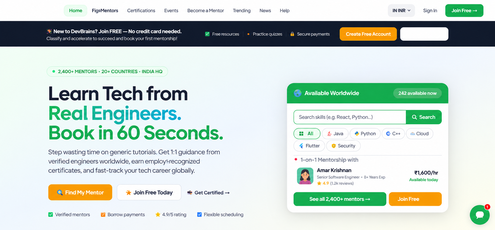

---

# 1. Project Overview

## Project Details

| Property | Description |
|---|---|
| Project Name | Mentor Application |
| Application Type | Web Application |
| Frontend | ASP.NET Core MVC / Razor |
| Programming Language | C# |
| UI Design | HTML, CSS, Bootstrap |
| Database Connectivity | Entity Framework Core |
| Database | SQL Server |
| Authentication | ASP.NET Core Identity, Google / Facebook OAuth |
| Email | SMTP / Email Service |
| API Testing | Swagger |
| IDE | Visual Studio |
| Architecture | Layered Architecture |
| Users | User and Mentor |
| Deployment | Web Server / Cloud Hosting |

## Project Description

The Mentor Application is designed to connect people who want guidance with experienced mentors.

Every registered account starts as a normal user. A user can enable mentor mode at any time, which creates a mentor profile and allows the user to define availability for appointments.

The application provides two primary roles:

1. **User**
   - Register and log in using email/password, Google, or Facebook.
   - Manage the personal profile.
   - Search mentors by name, skill, technology, or professional title.
   - View mentor details and availability.
   - Book appointments with mentors.
   - View and cancel their own appointments.
   - Receive email confirmations.

2. **Mentor**
   - Everything a User can do.
   - Enable mentor mode.
   - Create and maintain a mentor profile.
   - Manage skills.
   - Define weekly availability.
   - View appointments booked with them.
   - Confirm or reject appointment requests.

A mentor is a normal user with `IsMentor = true`.

---

# 2. Problem Statement

Finding a suitable mentor and arranging a meeting through informal channels can create several problems:

- Users do not know where to find mentors with specific skills.
- Mentor availability is not visible to users.
- Appointment requests are exchanged manually through messages or calls.
- Two users may request the same time slot with the same mentor.
- Mentors may miss new appointment requests.
- Users do not receive confirmation of their bookings.
- Maintaining appointment history is difficult.

## Proposed Solution

Develop a centralized web application that:

- Provides secure registration and login, including social login.
- Allows any user to become a mentor.
- Maintains mentor profiles, skills, and availability.
- Allows users to search and discover mentors.
- Shows only the available appointment slots.
- Prevents double booking for the same mentor, date, and time.
- Tracks appointment status from request to completion.
- Sends email notifications for important appointment events.

---

# 3. Technology Stack

| Technology | Usage |
|---|---|
| C# | Application development |
| ASP.NET Core | Backend framework |
| ASP.NET Core MVC / Razor | Web UI |
| Entity Framework Core | Object-relational mapping |
| ASP.NET Core Identity | Authentication and user management |
| Google / Facebook OAuth | Social login |
| SQL Server | Database |
| HTML, CSS, Bootstrap | User interface design |
| SMTP / Email Service | Email notifications |
| Swagger | API testing |
| Visual Studio | Development environment |

## Why ASP.NET Core?

ASP.NET Core is a cross-platform, high-performance framework from Microsoft for building web applications and APIs.

Advantages:

- MVC pattern with clear separation of concerns.
- Built-in dependency injection.
- Built-in authentication and authorization support.
- Razor views for server-side rendering.
- Cross-platform and cloud-ready.

## Why Entity Framework Core?

Entity Framework Core is an object-relational mapper (ORM) used to communicate with SQL Server using C# objects instead of writing all SQL manually.

Important classes:

| Class | Purpose |
|---|---|
| DbContext | Represents a session with the database |
| DbSet&lt;T&gt; | Represents a table that can be queried and saved |
| Migration | Creates and updates the database schema |
| LINQ | Queries data using C# |
| SaveChangesAsync | Saves changes inside a transaction |

## Why ASP.NET Core Identity?

ASP.NET Core Identity provides user registration, login, password hashing, roles, and external login support.

Important classes:

| Class | Purpose |
|---|---|
| UserManager&lt;T&gt; | Create and manage users |
| SignInManager&lt;T&gt; | Handle login and logout |
| RoleManager&lt;T&gt; | Manage roles |
| IdentityUser | Base user entity |
| ExternalLoginInfo | Social login information |

## Why SQL Server?

SQL Server provides a reliable relational database with constraints, indexes, and transactions that protect appointment data.

---

# 4. Application Roles

## 4.1 User

Every registered account starts as a normal user (`IsMentor = false`).

Features:

- Register.
- Login (Email/Password, Google, Facebook).
- Forgot Password.
- Home Screen.
- My Profile and Edit Profile.
- Enable Mentor.
- Find Mentor.
- Search Mentor.
- Mentor Details.
- Book Appointment.
- My Appointments.
- Cancel Appointment.
- Email Confirmation.

## 4.2 Mentor

A user becomes a mentor after selecting **Enable Mentor** (`IsMentor = true`).

Features:

- All User features.
- Mentor Profile.
- Skills Management.
- Availability Management.
- Mentor Appointments.
- Confirm Appointment.
- Reject Appointment.
- New Appointment Email.

A mentor cannot book an appointment with themselves.

---

# 5. Application Screens

| Screen ID | Screen Name | Description |
|---|---|---|
| S01 | Welcome | Entry page with Create Account and Login |
| S02 | Register | Create a new account |
| S03 | Login | Email/password and social login |
| S04 | Home | Search, popular skills, recommended mentors |
| S05 | My Profile | View user profile |
| S06 | Edit Profile | Update user information |
| S07 | Enable Mentor / Mentor Profile | Create and maintain mentor information |
| S08 | Mentor Availability | Define available days and times |
| S09 | Mentor List | Display and search mentors |
| S10 | Mentor Details | Display mentor profile and availability |
| S11 | Book Appointment | Select date, time, and message |
| S12 | My Appointments | Display appointments booked by the user |
| S13 | Mentor Appointments | Confirm or reject appointment requests |
| S14 | Forgot Password | Reset password by email |


 
## 5.1 Registration

Users can create a new account.

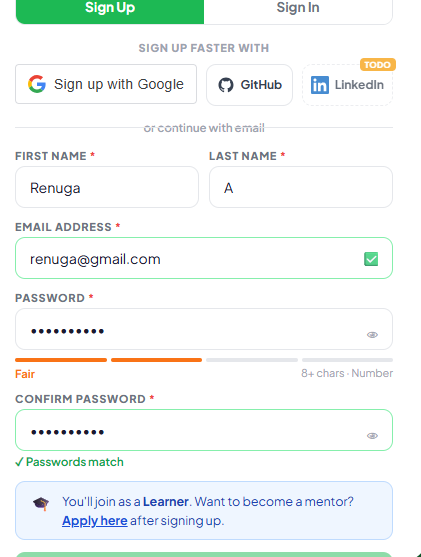

### Registration Fields

- First Name
- Last Name
- Email
- Phone Number
- Password
- Confirm Password


### Registration Flow

```text
Enter Registration Details
          ↓
Validate Details
          ↓
Create User Account
          ↓
Save User in SQL Server
          ↓
Redirect to Login
```

## 5.2 Social Login

Users can also log in using:

- Google
- Facebook

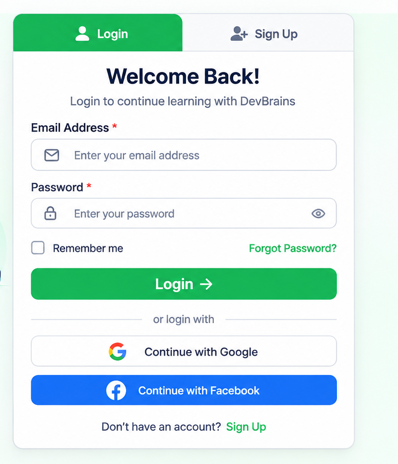

```text
 │
 ├── Email + Password
 │
 ├── Google
 │
 └── Facebook
```

Social authentication will be implemented using OAuth authentication supported by ASP.NET Core.

## 5.3 Login

Users can log in using:

```text
Email
Password
```

After successful authentication:

```text
Login
  ↓
Validate User
  ↓
Create Authentication Session
  ↓
Home Screen
```

## 5.4 Home Screen

After login, users will see the main dashboard.

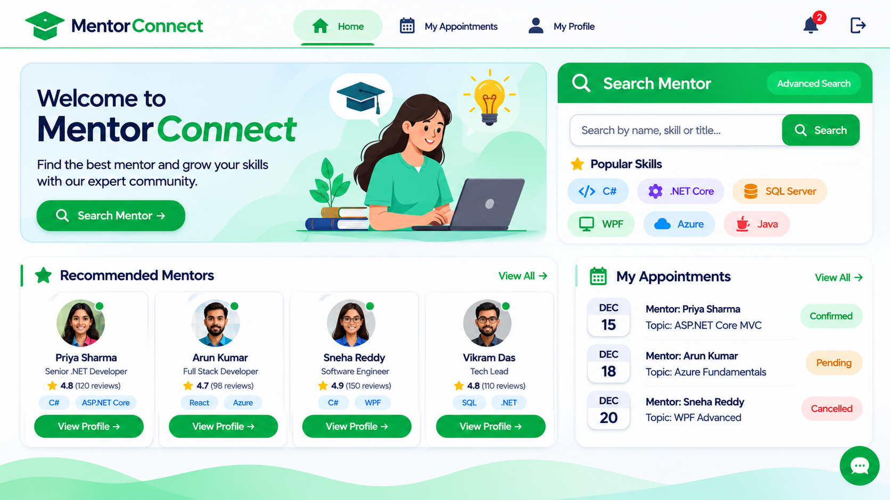

### Home Screen Features

- Welcome message
- Search Mentor
- Popular Skills
- Mentor List
- Recommended Mentors
- My Appointments
- My Profile

### Example

```text
--------------------------------------------------
                    MentorApp
--------------------------------------------------

Welcome, John!

Search Mentor
[ Search by name or skill................ ] [Search]

Popular Skills

[C#] [ASP.NET Core] [Azure] [SQL] [Python]

Recommended Mentors

--------------------------------------------------
John Smith
Senior .NET Developer

C# | .NET | Azure

[View Profile]
--------------------------------------------------

David Kumar
Azure Architect

Azure | Cloud | .NET

[View Profile]
--------------------------------------------------
```

## 5.5 User Profile

Every registered user will have a profile.

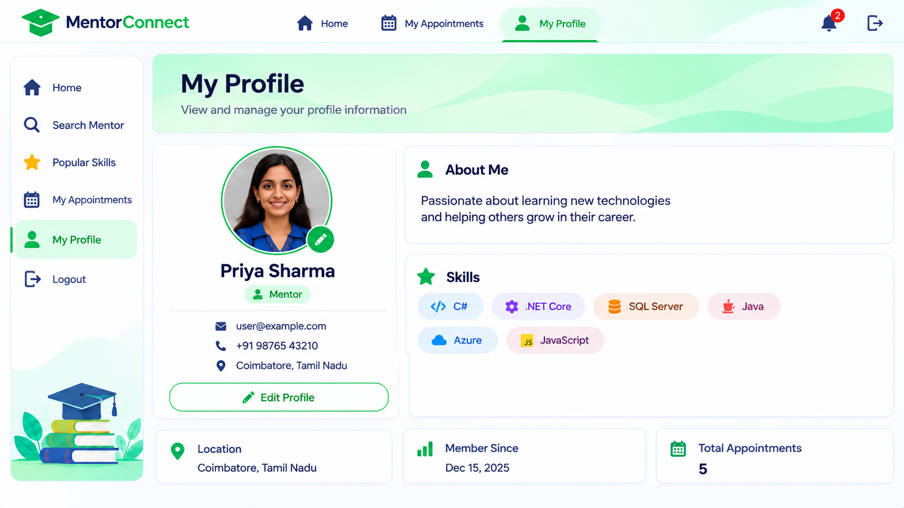

### Profile Information

```text
First Name
Last Name
Email
Phone
Profile Image
Bio
Location
```

Users can edit their profile.


```text
Home
 ↓
My Profile
 ↓
Edit Profile
 ↓
Save
```

## 5.6 Enable Mentor

A normal user can become a mentor.

Initially:

```text
IsMentor = false
```

When the user selects **Enable Mentor**:

```text
User
 ↓
Enable Mentor
 ↓
IsMentor = true
 ↓
Create Mentor Profile
 ↓
Set Mentor Information
 ↓
Set Availability
```

## 5.7 Mentor Profile

Mentors will have additional information.

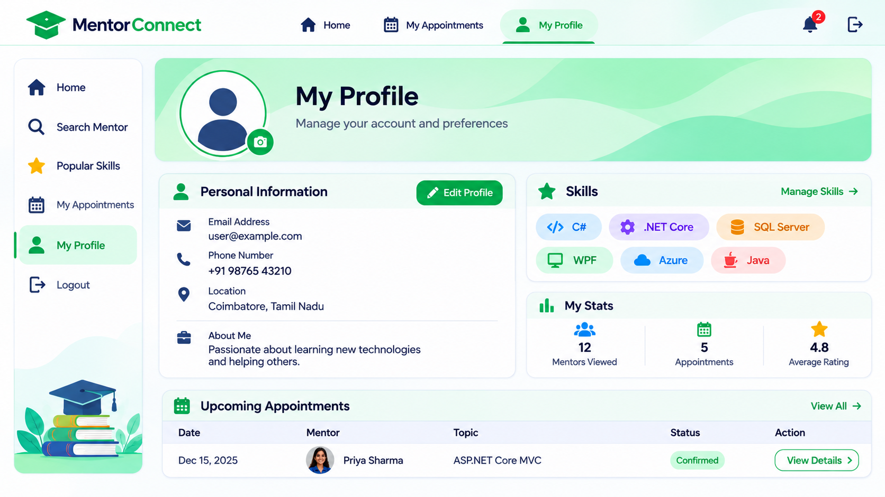


### Mentor Information

```text
Professional Title
Experience
About
Skills
Availability
```

### Example

```text
John Smith

Senior .NET Developer

Experience:
10 Years

Skills:
C#
ASP.NET Core
SQL Server
Azure

About:
Experienced .NET developer and mentor.

Availability:
Monday    09:00 AM - 11:00 AM
Tuesday   02:00 PM - 05:00 PM
Thursday  10:00 AM - 01:00 PM
```

## 5.8 Mentor Availability

Mentors can define when they are available for appointments.


### Example

```text
Monday
09:00 AM - 11:00 AM

Tuesday
02:00 PM - 05:00 PM

Wednesday
10:00 AM - 01:00 PM
```

### Availability Fields

```text
Day
Start Time
End Time
Is Active
```

## 5.9 Mentor List

Users can view all available mentors.

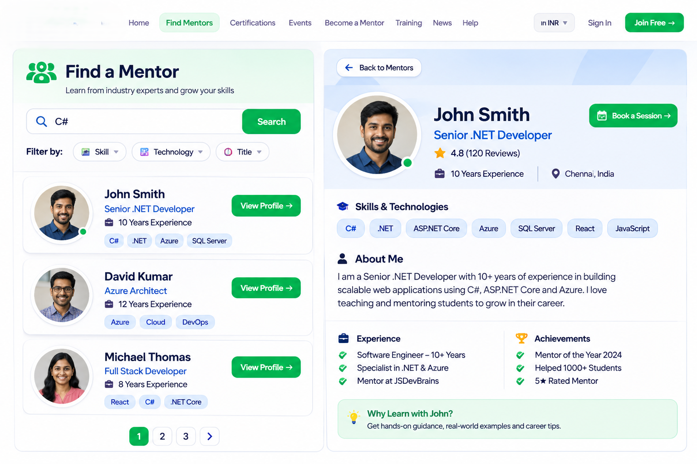

```text
--------------------------------------------------
Find a Mentor
--------------------------------------------------

Search:
[ C# Development                    ] [Search]

--------------------------------------------------

John Smith
Senior .NET Developer
10 Years Experience

C# | .NET | Azure | SQL Server

[View Profile]
--------------------------------------------------

David Kumar
Azure Architect
12 Years Experience

Azure | Cloud | DevOps

[View Profile]
--------------------------------------------------
```

### Search Mentor

Users should be able to search mentors by:

- Name
- Skill
- Technology
- Professional Title

```text
Search: C#

       ↓

John Smith
David Kumar
Michael Thomas
```

## 5.10 Mentor Details

When the user selects **View Profile**, the mentor details page will display:

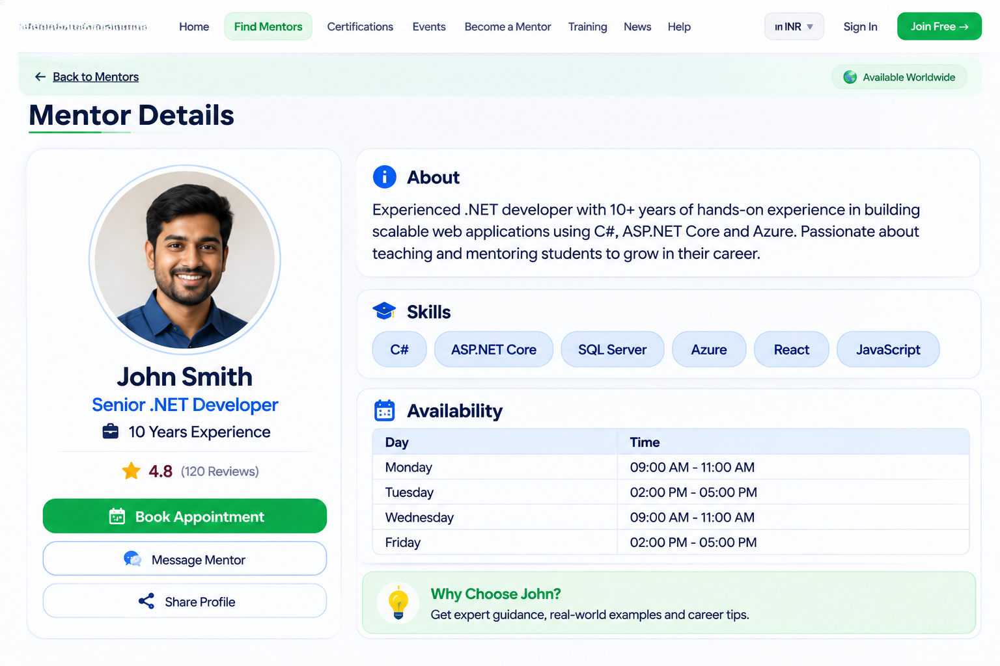

```text
Profile Image

John Smith

Senior .NET Developer

10 Years Experience

About
--------------------------------
Experienced .NET developer...

Skills
--------------------------------
C#
ASP.NET Core
SQL Server
Azure

Availability
--------------------------------
Monday    09:00 AM - 11:00 AM
Tuesday   02:00 PM - 05:00 PM

              [Book Appointment]
```

## 5.11 Book Appointment

Users can book an appointment with an available mentor.

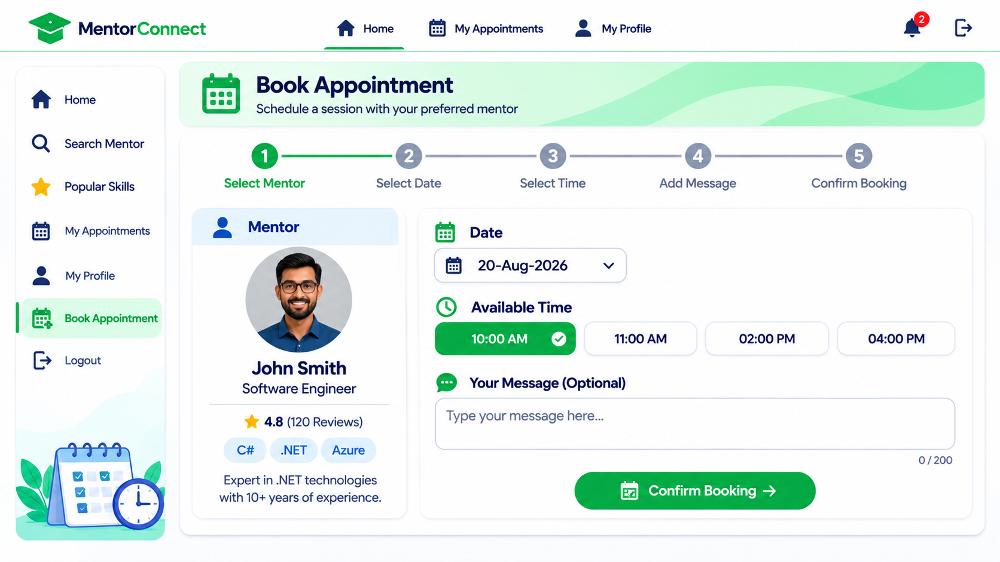

### Booking Flow

```text
Select Mentor
      ↓
Select Date
      ↓
Select Available Time
      ↓
Enter Message
      ↓
Confirm Booking
      ↓
Create Appointment
      ↓
Send Email
```

### Booking Screen

```text
Mentor
John Smith

Date
[ 20-Aug-2026 ]

Available Time

[10:00 AM]
[11:00 AM]
[02:00 PM]
[04:00 PM]

Message

[ I would like to discuss .NET architecture ]

             [Book Appointment]
```

## 5.12 Appointment Status

Appointments can have the following statuses:

```text
Pending
Confirmed
Rejected
Cancelled
Completed
```

```text
User books appointment
        ↓
     Pending
        ↓
Mentor confirms
        ↓
     Confirmed
        ↓
Appointment completed
        ↓
    Completed
```

## 5.13 My Appointments

Users can see their appointments.

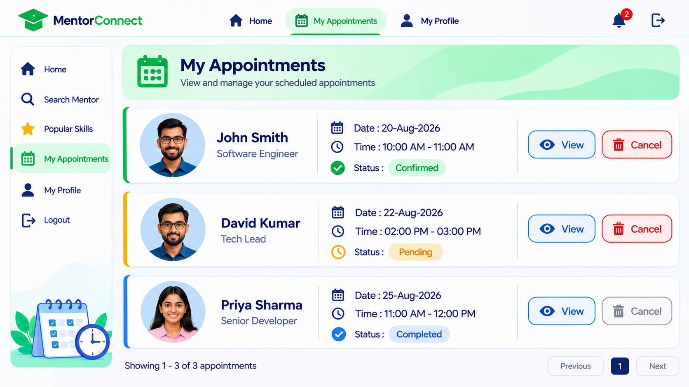

```text
--------------------------------------------------
My Appointments
--------------------------------------------------

Mentor: John Smith
Date: 20-Aug-2026
Time: 10:00 AM - 11:00 AM
Status: Confirmed

[View]
[Cancel]
--------------------------------------------------

Mentor: David Kumar
Date: 22-Aug-2026
Time: 02:00 PM - 03:00 PM
Status: Pending

[View]
[Cancel]
--------------------------------------------------
```

## 5.14 Mentor Appointments

Mentors can view appointments booked with them.

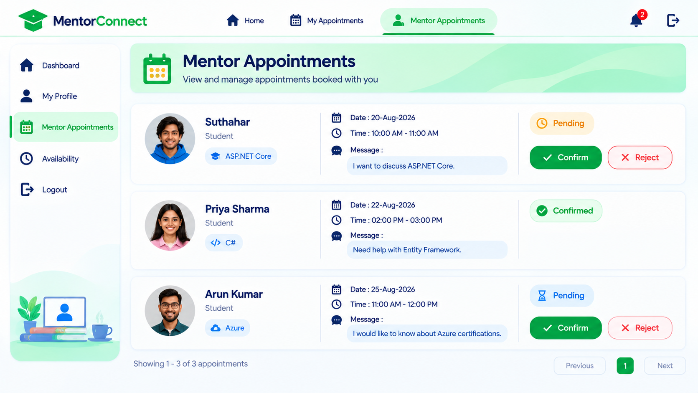

```text
--------------------------------------------------
Mentor Appointments
--------------------------------------------------

Student: Suthahar
Date: 20-Aug-2026
Time: 10:00 AM - 11:00 AM

Message:
I want to discuss ASP.NET Core.

Status: Pending

[Confirm] [Reject]
--------------------------------------------------
```

## 5.15 Email Notification

The application will send emails when important appointment events occur.


```text
User
 ↓
Book Appointment
 ↓
Save Appointment
 ↓
Send Email
 ├── User
 └── Mentor
```

### User Email

```text
Subject:
Mentor Appointment Confirmation

Hello,

Your appointment with John Smith has been booked.

Date: 20-Aug-2026
Time: 10:00 AM - 11:00 AM

Thank you.
Mentor Application
```

### Mentor Email

```text
Subject:
New Mentor Appointment

Hello John,

You have received a new appointment request.

Student: Suthahar
Date: 20-Aug-2026
Time: 10:00 AM - 11:00 AM

Please check your dashboard.
```

## 5.16 Forgot Password

Users can reset their password using their registered email address.

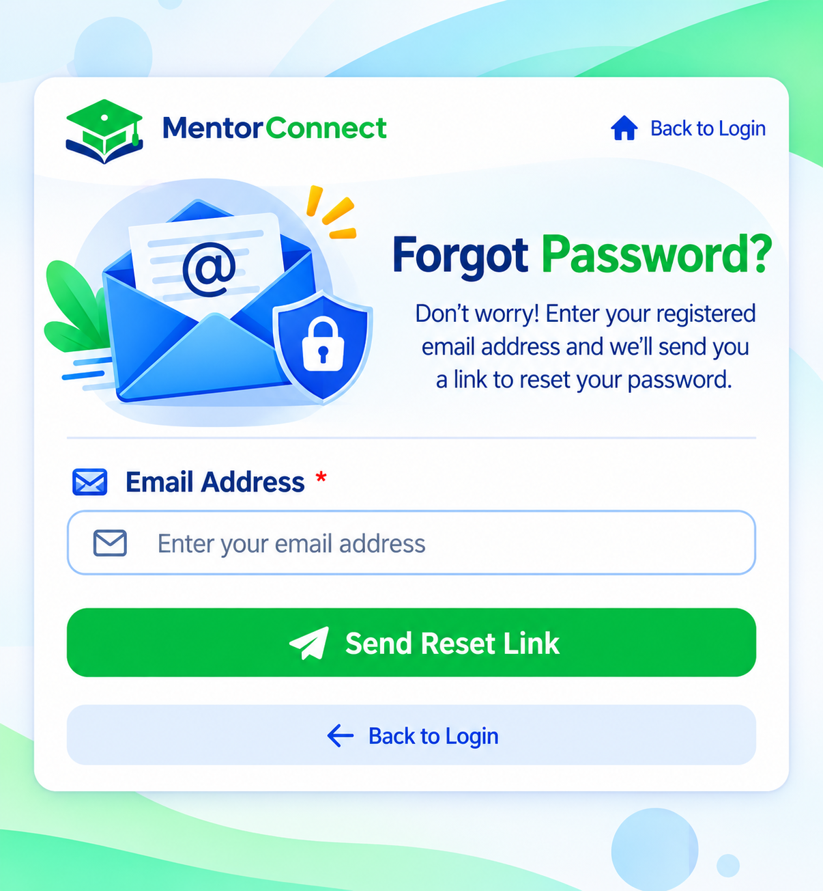

---

# 6. Database Design

Database Name:

`MentorAppDB`

The application uses a SQL Server database accessed through Entity Framework Core.

> **Note:** ASP.NET Core Identity creates its own tables (for example `AspNetUsers`, `AspNetRoles`, `AspNetUserRoles`, `AspNetUserLogins`). The `Users`, `Roles`, `UserRoles`, and `ExternalLogins` tables below describe the same data conceptually. In the implementation, the Identity user is extended with the additional profile columns.

## Database Tables

| No. | Table Name | Purpose |
|---|---|---|
| 1 | Roles | Maintain application roles |
| 2 | Users | Maintain user accounts and profile information |
| 3 | UserRoles | Maintain the roles assigned to users |
| 4 | MentorProfiles | Maintain mentor-specific information |
| 5 | Skills | Maintain the list of skills |
| 6 | MentorSkills | Maintain the skills of each mentor |
| 7 | MentorAvailabilities | Maintain mentor weekly availability |
| 8 | Appointments | Maintain appointment bookings |
| 9 | ExternalLogins | Maintain Google / Facebook login links |
| 10 | EmailLogs | Maintain email notification history |

## 6.1 Roles Table

Table Name: `Roles`

Stores application role information.

| Column | Data Type | Constraint | Description |
|---|---|---|---|
| Id | INT | PK, Identity | Unique role ID |
| Name | NVARCHAR(50) | NOT NULL, UNIQUE | User / Mentor |
| Description | NVARCHAR(250) | NULL | Role description |
| CreatedDate | DATETIME2 | NOT NULL | Created date |

Example Data:

| Id | Name |
|---|---|
| 1 | User |
| 2 | Mentor |

## 6.2 Users Table

Table Name: `Users`

Stores user login and profile information.

| Column | Data Type | Constraint | Description |
|---|---|---|---|
| Id | INT | PK, Identity | Unique user ID |
| FirstName | NVARCHAR(100) | NOT NULL | First name |
| LastName | NVARCHAR(100) | NOT NULL | Last name |
| Email | NVARCHAR(150) | NOT NULL, UNIQUE | Login email |
| PasswordHash | NVARCHAR(500) | NULL | Hashed password (NULL for social-only accounts) |
| PhoneNumber | NVARCHAR(20) | NULL | Phone number |
| ProfileImage | NVARCHAR(300) | NULL | Profile image path |
| Bio | NVARCHAR(500) | NULL | Short biography |
| Location | NVARCHAR(150) | NULL | User location |
| IsMentor | BIT | NOT NULL | Mentor mode status |
| CreatedDate | DATETIME2 | NOT NULL | Created date |
| UpdatedDate | DATETIME2 | NULL | Updated date |

## 6.3 UserRoles Table

Table Name: `UserRoles`

Stores the roles assigned to each user.

| Column | Data Type | Constraint | Description |
|---|---|---|---|
| UserId | INT | PK, FK | User ID |
| RoleId | INT | PK, FK | Role ID |

Relationships:

- `Users.Id → UserRoles.UserId`
- `Roles.Id → UserRoles.RoleId`

## 6.4 MentorProfiles Table

Table Name: `MentorProfiles`

Stores mentor-specific information.

| Column | Data Type | Constraint | Description |
|---|---|---|---|
| Id | INT | PK, Identity | Mentor profile ID |
| UserId | INT | FK, NOT NULL, UNIQUE | Related user |
| ProfessionalTitle | NVARCHAR(150) | NOT NULL | Professional title |
| ExperienceYears | INT | NOT NULL | Years of experience |
| About | NVARCHAR(1000) | NULL | About the mentor |
| IsAvailable | BIT | NOT NULL | Accepting appointments |
| CreatedDate | DATETIME2 | NOT NULL | Created date |
| UpdatedDate | DATETIME2 | NULL | Updated date |

Relationship:

`Users.Id → MentorProfiles.UserId` (one user has at most one mentor profile)

```text
User
  │
  └────── MentorProfile
```

## 6.5 Skills Table

Table Name: `Skills`

Stores the list of skills that mentors can select.

| Column | Data Type | Constraint | Description |
|---|---|---|---|
| Id | INT | PK, Identity | Skill ID |
| Name | NVARCHAR(100) | NOT NULL, UNIQUE | Skill name |

Example:

| Id | Name |
|---|---|
| 1 | C# |
| 2 | ASP.NET Core |
| 3 | SQL Server |
| 4 | Azure |
| 5 | Python |
| 6 | Angular |
| 7 | React |

## 6.6 MentorSkills Table

Table Name: `MentorSkills`

A mentor can have multiple skills, and a skill can belong to multiple mentors.

| Column | Data Type | Constraint | Description |
|---|---|---|---|
| MentorId | INT | PK, FK | Mentor profile ID |
| SkillId | INT | PK, FK | Skill ID |

Relationships:

- `MentorProfiles.Id → MentorSkills.MentorId`
- `Skills.Id → MentorSkills.SkillId`

```text
John Smith
    │
    ├── C#
    ├── ASP.NET Core
    ├── SQL Server
    └── Azure
```

## 6.7 MentorAvailabilities Table

Table Name: `MentorAvailabilities`

Stores the weekly availability of each mentor.

| Column | Data Type | Constraint | Description |
|---|---|---|---|
| Id | INT | PK, Identity | Availability ID |
| MentorId | INT | FK, NOT NULL | Mentor profile ID |
| DayOfWeek | NVARCHAR(10) | NOT NULL | Monday to Sunday |
| StartTime | TIME | NOT NULL | Start time |
| EndTime | TIME | NOT NULL | End time |
| IsActive | BIT | NOT NULL | Availability status |

Relationship:

`MentorProfiles.Id → MentorAvailabilities.MentorId`

Example:

| Id | MentorId | Day | Start | End |
|---|---|---|---|---|
| 1 | 10 | Monday | 09:00 | 11:00 |
| 2 | 10 | Monday | 14:00 | 17:00 |
| 3 | 10 | Tuesday | 10:00 | 13:00 |

## 6.8 Appointments Table

Table Name: `Appointments`

Stores appointment bookings between users and mentors.

| Column | Data Type | Constraint | Description |
|---|---|---|---|
| Id | INT | PK, Identity | Appointment ID |
| UserId | INT | FK, NOT NULL | User who booked |
| MentorId | INT | FK, NOT NULL | Mentor profile ID |
| AppointmentDate | DATE | NOT NULL | Appointment date |
| StartTime | TIME | NOT NULL | Start time |
| EndTime | TIME | NOT NULL | End time |
| Message | NVARCHAR(500) | NULL | Message from the user |
| Status | NVARCHAR(20) | NOT NULL | Pending / Confirmed / Rejected / Cancelled / Completed |
| CreatedDate | DATETIME2 | NOT NULL | Created date |
| UpdatedDate | DATETIME2 | NULL | Updated date |

Relationships:

- `Users.Id → Appointments.UserId`
- `MentorProfiles.Id → Appointments.MentorId`

```text
User
  │
  └──── Appointment
              │
              └──── Mentor
```

Important Business Rule:

A mentor cannot have two active (`Pending` or `Confirmed`) appointments for the same date and start time. Cancelled and Rejected appointments free the slot again.

## 6.9 ExternalLogins Table

Table Name: `ExternalLogins`

Stores the links between a user account and a Google or Facebook login.

| Column | Data Type | Constraint | Description |
|---|---|---|---|
| Id | INT | PK, Identity | External login ID |
| UserId | INT | FK, NOT NULL | Related user |
| Provider | NVARCHAR(50) | NOT NULL | Google / Facebook |
| ProviderKey | NVARCHAR(200) | NOT NULL | User ID from the provider |
| CreatedDate | DATETIME2 | NOT NULL | Created date |

Relationship:

`Users.Id → ExternalLogins.UserId`

## 6.10 EmailLogs Table

Table Name: `EmailLogs`

Maintains the history of email notifications.

| Column | Data Type | Constraint | Description |
|---|---|---|---|
| Id | BIGINT | PK, Identity | Email log ID |
| UserId | INT | FK, NULL | Recipient user |
| ToEmail | NVARCHAR(150) | NOT NULL | Recipient email |
| Subject | NVARCHAR(200) | NOT NULL | Email subject |
| Status | NVARCHAR(20) | NOT NULL | Sent / Failed |
| ErrorMessage | NVARCHAR(500) | NULL | Failure reason |
| CreatedDate | DATETIME2 | NOT NULL | Created date |

Relationship:

`Users.Id → EmailLogs.UserId`

Do not store passwords, reset tokens, or other secrets in email logs.

---

# 7. Complete Database Relationship Diagram


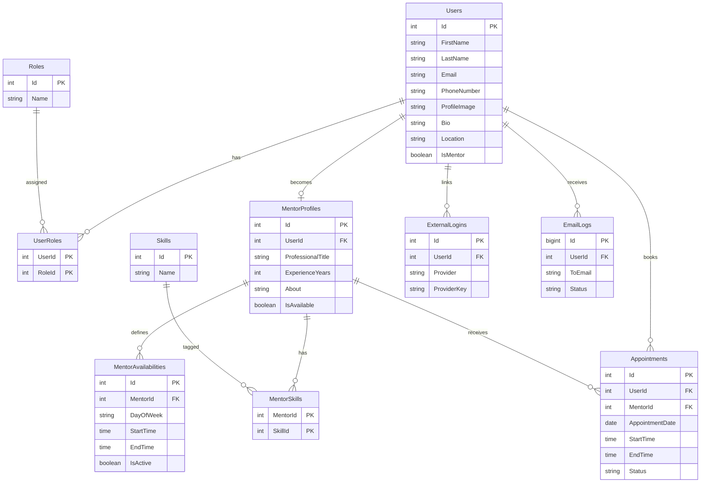

---

# 8. SQL Server Database Creation

```sql
CREATE DATABASE MentorAppDB;
GO

USE MentorAppDB;
GO
```

## 8.1 Create Roles

```sql
CREATE TABLE Roles
(
    Id INT IDENTITY(1,1) PRIMARY KEY,
    Name NVARCHAR(50) NOT NULL UNIQUE,
    Description NVARCHAR(250) NULL,
    CreatedDate DATETIME2 NOT NULL DEFAULT SYSUTCDATETIME()
);
```

## 8.2 Create Users

```sql
CREATE TABLE Users
(
    Id INT IDENTITY(1,1) PRIMARY KEY,
    FirstName NVARCHAR(100) NOT NULL,
    LastName NVARCHAR(100) NOT NULL,
    Email NVARCHAR(150) NOT NULL UNIQUE,
    PasswordHash NVARCHAR(500) NULL,
    PhoneNumber NVARCHAR(20) NULL,
    ProfileImage NVARCHAR(300) NULL,
    Bio NVARCHAR(500) NULL,
    Location NVARCHAR(150) NULL,
    IsMentor BIT NOT NULL DEFAULT 0,
    CreatedDate DATETIME2 NOT NULL DEFAULT SYSUTCDATETIME(),
    UpdatedDate DATETIME2 NULL
);
```

## 8.3 Create UserRoles

```sql
CREATE TABLE UserRoles
(
    UserId INT NOT NULL,
    RoleId INT NOT NULL,

    CONSTRAINT PK_UserRoles
        PRIMARY KEY (UserId, RoleId),

    CONSTRAINT FK_UserRoles_Users
        FOREIGN KEY (UserId) REFERENCES Users(Id),

    CONSTRAINT FK_UserRoles_Roles
        FOREIGN KEY (RoleId) REFERENCES Roles(Id)
);
```

## 8.4 Create MentorProfiles

```sql
CREATE TABLE MentorProfiles
(
    Id INT IDENTITY(1,1) PRIMARY KEY,
    UserId INT NOT NULL UNIQUE,
    ProfessionalTitle NVARCHAR(150) NOT NULL,
    ExperienceYears INT NOT NULL DEFAULT 0,
    About NVARCHAR(1000) NULL,
    IsAvailable BIT NOT NULL DEFAULT 1,
    CreatedDate DATETIME2 NOT NULL DEFAULT SYSUTCDATETIME(),
    UpdatedDate DATETIME2 NULL,

    CONSTRAINT FK_MentorProfiles_Users
        FOREIGN KEY (UserId) REFERENCES Users(Id),

    CONSTRAINT CK_MentorProfiles_Experience
        CHECK (ExperienceYears >= 0)
);
```

## 8.5 Create Skills

```sql
CREATE TABLE Skills
(
    Id INT IDENTITY(1,1) PRIMARY KEY,
    Name NVARCHAR(100) NOT NULL UNIQUE
);
```

## 8.6 Create MentorSkills

```sql
CREATE TABLE MentorSkills
(
    MentorId INT NOT NULL,
    SkillId INT NOT NULL,

    CONSTRAINT PK_MentorSkills
        PRIMARY KEY (MentorId, SkillId),

    CONSTRAINT FK_MentorSkills_MentorProfiles
        FOREIGN KEY (MentorId) REFERENCES MentorProfiles(Id),

    CONSTRAINT FK_MentorSkills_Skills
        FOREIGN KEY (SkillId) REFERENCES Skills(Id)
);
```

## 8.7 Create MentorAvailabilities

```sql
CREATE TABLE MentorAvailabilities
(
    Id INT IDENTITY(1,1) PRIMARY KEY,
    MentorId INT NOT NULL,
    [DayOfWeek] NVARCHAR(10) NOT NULL,
    StartTime TIME NOT NULL,
    EndTime TIME NOT NULL,
    IsActive BIT NOT NULL DEFAULT 1,

    CONSTRAINT FK_MentorAvailabilities_MentorProfiles
        FOREIGN KEY (MentorId) REFERENCES MentorProfiles(Id),

    CONSTRAINT CK_MentorAvailabilities_Day
        CHECK ([DayOfWeek] IN
        ('Monday', 'Tuesday', 'Wednesday', 'Thursday',
         'Friday', 'Saturday', 'Sunday')),

    CONSTRAINT CK_MentorAvailabilities_Time
        CHECK (EndTime > StartTime)
);
```

## 8.8 Create Appointments

```sql
CREATE TABLE Appointments
(
    Id INT IDENTITY(1,1) PRIMARY KEY,
    UserId INT NOT NULL,
    MentorId INT NOT NULL,
    AppointmentDate DATE NOT NULL,
    StartTime TIME NOT NULL,
    EndTime TIME NOT NULL,
    Message NVARCHAR(500) NULL,
    Status NVARCHAR(20) NOT NULL DEFAULT 'Pending',
    CreatedDate DATETIME2 NOT NULL DEFAULT SYSUTCDATETIME(),
    UpdatedDate DATETIME2 NULL,

    CONSTRAINT FK_Appointments_Users
        FOREIGN KEY (UserId) REFERENCES Users(Id),

    CONSTRAINT FK_Appointments_MentorProfiles
        FOREIGN KEY (MentorId) REFERENCES MentorProfiles(Id),

    CONSTRAINT CK_Appointments_Status
        CHECK (Status IN
        ('Pending', 'Confirmed', 'Rejected', 'Cancelled', 'Completed')),

    CONSTRAINT CK_Appointments_Time
        CHECK (EndTime > StartTime)
);
GO

-- Prevent double booking: only one active appointment per
-- mentor, date and start time. Cancelled / Rejected rows free the slot.
CREATE UNIQUE INDEX UX_Appointments_NoDoubleBooking
ON Appointments (MentorId, AppointmentDate, StartTime)
WHERE Status IN ('Pending', 'Confirmed');
```

## 8.9 Create ExternalLogins

```sql
CREATE TABLE ExternalLogins
(
    Id INT IDENTITY(1,1) PRIMARY KEY,
    UserId INT NOT NULL,
    Provider NVARCHAR(50) NOT NULL,
    ProviderKey NVARCHAR(200) NOT NULL,
    CreatedDate DATETIME2 NOT NULL DEFAULT SYSUTCDATETIME(),

    CONSTRAINT FK_ExternalLogins_Users
        FOREIGN KEY (UserId) REFERENCES Users(Id),

    CONSTRAINT UQ_ExternalLogins_Provider
        UNIQUE (Provider, ProviderKey)
);
```

## 8.10 Create EmailLogs

```sql
CREATE TABLE EmailLogs
(
    Id BIGINT IDENTITY(1,1) PRIMARY KEY,
    UserId INT NULL,
    ToEmail NVARCHAR(150) NOT NULL,
    Subject NVARCHAR(200) NOT NULL,
    Status NVARCHAR(20) NOT NULL,
    ErrorMessage NVARCHAR(500) NULL,
    CreatedDate DATETIME2 NOT NULL DEFAULT SYSUTCDATETIME(),

    CONSTRAINT FK_EmailLogs_Users
        FOREIGN KEY (UserId) REFERENCES Users(Id),

    CONSTRAINT CK_EmailLogs_Status
        CHECK (Status IN ('Sent', 'Failed'))
);
```

## 8.11 Insert Initial Roles and Skills

```sql
INSERT INTO Roles (Name, Description)
VALUES
('User', 'Normal application user'),
('Mentor', 'User who offers mentoring');

INSERT INTO Skills (Name)
VALUES
('C#'),
('ASP.NET Core'),
('SQL Server'),
('Azure'),
('Python'),
('Angular'),
('React');
```

---

# 9. Application Flow Diagrams

## 9.1 Registration and Login Flow

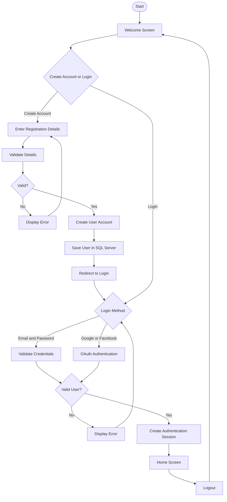

## 9.2 Enable Mentor Flow

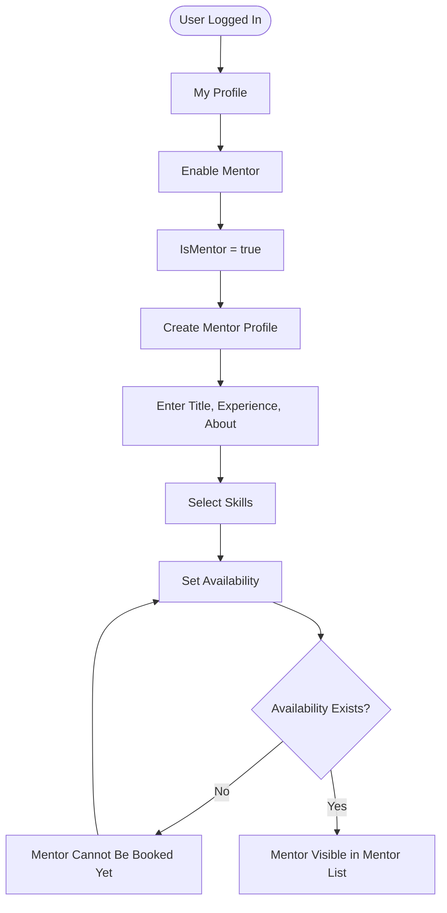

## 9.3 Booking Flow

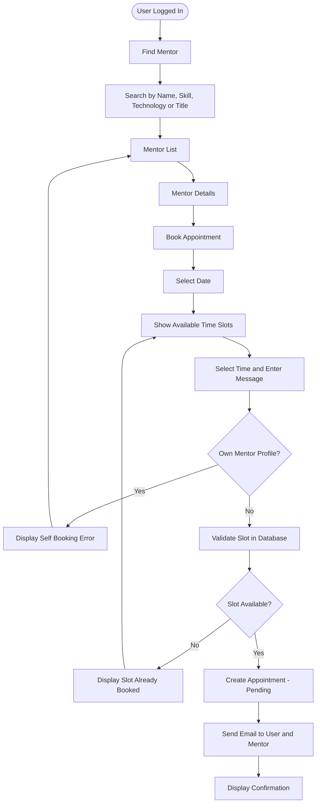

## 9.4 Mentor Appointment Management Flow

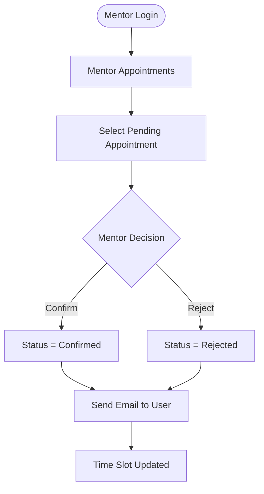

## 9.5 Appointment Status Flow

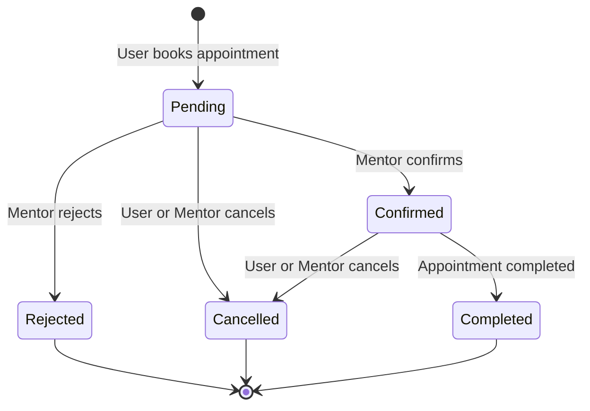

---

# 10. System Architecture

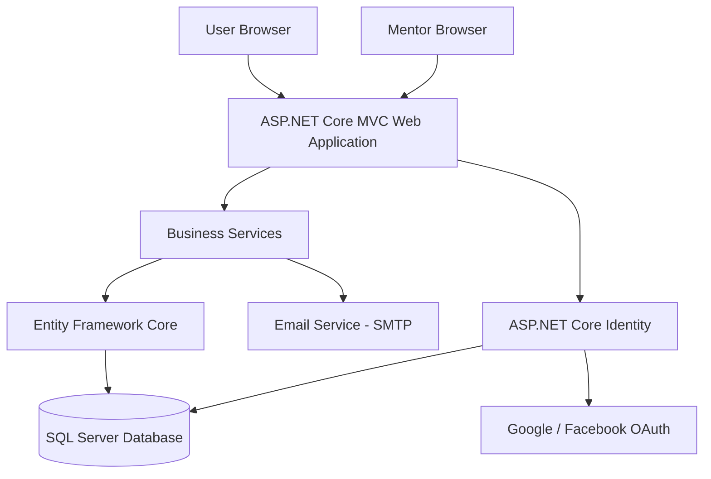

All users and mentors access the same central data through the web application.

## Important Booking Scenario

Assume a mentor has only one available slot on a date.

- User A selects the slot.
- User B selects the same slot.
- Both users attempt to confirm their bookings.

The system must not allow both bookings.

Use two protections:

1. Check the slot before saving.
2. Rely on the unique index `UX_Appointments_NoDoubleBooking` as the final protection.

```csharp
try
{
    _context.Appointments.Add(appointment);
    await _context.SaveChangesAsync();
}
catch (DbUpdateException ex)
    when (ex.InnerException is SqlException { Number: 2601 or 2627 })
{
    // Unique index violation - another user booked this slot first.
    // Display "Slot already booked" and reload the available slots.
}
```

Check the result:

- Save succeeds: The appointment is created.
- Unique index violation: The slot is no longer available.

The unique index protects exact slot conflicts. If different start times can overlap (for example 10:00-11:00 and 10:30-11:30), the overlap must also be checked in the booking service.

---

# 11. Recommended Project Folder Structure

```text
MentorApp.sln
README.md
|
+-- Images
|   +-- Mentor-Application-Showcase.png
|   +-- Welcome.png
|   +-- Register.png
|   +-- Login.png
|   +-- Home.png
|   +-- Profile.png
|   +-- Edit-Profile.png
|   +-- Mentor-Profile.png
|   +-- Mentor-Availability.png
|   +-- Mentor-List.png
|   +-- Mentor-Details.png
|   +-- Book-Appointment.png
|   +-- My-Appointments.png
|   +-- Mentor-Appointments.png
|   +-- Forgot-Password.png
|   +-- Email-Notification.png
|   +-- Database-Diagram.png
|
+-- MentorApp.Web
|   |
|   +-- Controllers
|   |   +-- AccountController.cs
|   |   +-- HomeController.cs
|   |   +-- ProfileController.cs
|   |   +-- MentorController.cs
|   |   +-- AppointmentController.cs
|   |
|   +-- Views
|   |   +-- Account
|   |   |   +-- Login.cshtml
|   |   |   +-- Register.cshtml
|   |   |
|   |   +-- Home
|   |   |   +-- Index.cshtml
|   |   |
|   |   +-- Profile
|   |   |   +-- Edit.cshtml
|   |   |
|   |   +-- Mentor
|   |   |   +-- Index.cshtml
|   |   |   +-- Details.cshtml
|   |   |
|   |   +-- Appointment
|   |       +-- Book.cshtml
|   |       +-- MyAppointments.cshtml
|   |
|   +-- wwwroot
|   +-- Program.cs
|
+-- MentorApp.Core
|   |
|   +-- Entities
|   +-- DTOs
|   +-- Interfaces
|   +-- Enums
|
+-- MentorApp.Infrastructure
|   |
|   +-- Data
|   +-- Repositories
|   +-- Services
|   +-- Email
|
+-- MentorApp.Tests
    |
    +-- UnitTests
    +-- IntegrationTests
```

---

# 12. Important Business Rules

1. Every new account starts as a normal user (`IsMentor = false`).
2. A user must explicitly enable mentor mode (`IsMentor = true`).
3. A mentor should configure availability before users can book appointments.
4. A mentor cannot book an appointment with themselves.
5. A mentor cannot have two appointments for the same date and time.
6. Users should only see available appointment slots.
7. When an appointment is cancelled, the time slot becomes available again.
8. Email must be unique.
9. A user can have only one mentor profile.
10. Availability end time must be later than start time.
11. Appointment end time must be later than start time.
12. Appointments can be created only for future dates and times.
13. Appointment status must be one of Pending, Confirmed, Rejected, Cancelled, or Completed.
14. Only the mentor of an appointment can confirm or reject it.
15. Users can view and cancel only their own appointments.

---

# 13. Security Requirements

- Never store plain-text passwords.
- Use ASP.NET Core Identity password hashing.
- Use Entity Framework Core or parameterized SQL commands.
- Implement role-based and ownership-based authorization.
- Use HTTPS for all pages.
- Use anti-forgery tokens on all forms.
- Protect Google, Facebook, SMTP, and database secrets using User Secrets or environment variables.
- Avoid hardcoding credentials in source code.
- Validate profile image uploads (file type and size).
- Validate all input values on both client and server.
- Log important activities and email failures.
- Do not expose another user's appointment data.

**Production recommendation:** Store secrets in a secure service such as Azure Key Vault and never commit them to GitHub.

---

# 14. Development Plan

| Phase | Task | Expected Result |
|---|---|---|
| 1 | Project Setup | ASP.NET Core project, SQL Server, EF Core, Identity, database, and migrations configured |
| 2 | Authentication | Register, Login, Logout, Forgot Password, Google Login, Facebook Login |
| 3 | Profile | View Profile, Edit Profile, Profile Image, User Information |
| 4 | Mentor | Enable Mentor, Mentor Profile, Skills, Availability |
| 5 | Mentor Discovery | Mentor List, Search, Filter, Mentor Details |
| 6 | Appointment | Book Appointment, Available Time Slots, My Appointments, Mentor Appointments, Confirm, Reject, Cancel |
| 7 | Email | Appointment Confirmation, New Appointment Notification, Cancellation Notification |
| 8 | Testing | Validate all application features |
| 9 | Deployment | Publish the web application |

---

# 15. Testing Scenarios

| Test ID | Scenario | Expected Result |
|---|---|---|
| TC01 | Register with valid details | Account created and redirected to Login |
| TC02 | Register with an existing email | Error message displayed |
| TC03 | Login with valid credentials | Home screen opens |
| TC04 | Login with invalid password | Error message displayed |
| TC05 | Login using Google | Home screen opens |
| TC06 | Login using Facebook | Home screen opens |
| TC07 | Edit profile | Updated information saved |
| TC08 | Enable Mentor | IsMentor becomes true and mentor profile is created |
| TC09 | Add mentor availability | Availability saved |
| TC10 | Search mentor by skill | Matching mentors appear |
| TC11 | View mentor details | Profile, skills, and availability appear |
| TC12 | Book an available slot | Appointment created with Pending status |
| TC13 | Mentor books own profile | Booking blocked |
| TC14 | Two users book the same slot | Only one booking succeeds |
| TC15 | Mentor confirms appointment | Status changes to Confirmed |
| TC16 | Mentor rejects appointment | Status changes to Rejected |
| TC17 | User cancels appointment | Status changes to Cancelled and slot becomes available |
| TC18 | Appointment booked | Emails sent to user and mentor |
| TC19 | User opens another user's appointment | Access denied |
| TC20 | Mentor without availability | Mentor cannot be booked |

---

# 16. Student Project Demonstration

Students must demonstrate the complete application rather than simply showing the UI.

## Recommended Demonstration Order

1. Introduce the project.
2. Explain the problem being solved.
3. Explain the technology stack.
4. Register a new user.
5. Log in using email and password.
6. Show Google / Facebook login.
7. Show the Home screen.
8. Edit the user profile.
9. Enable Mentor and create the mentor profile.
10. Add skills and availability.
11. Log in as a second user.
12. Search for the mentor.
13. View the mentor details.
14. Book an appointment.
15. Show the confirmation email.
16. Log in as the mentor.
17. Confirm the appointment.
18. Show the user's updated appointment status.
19. Cancel an appointment and show the slot available again.
20. Explain the database relationships.

## Sample Student Presentation

"Good morning.

Our project is a Mentor Application developed using ASP.NET Core, C#, Entity Framework Core, ASP.NET Core Identity, and SQL Server.

The main objective of this application is to help users find mentors and book appointments easily.

Our application has two main roles: User and Mentor.

A user can register, log in using email, Google, or Facebook, manage a profile, search for mentors, and book appointments.

Any user can enable mentor mode, create a mentor profile, add skills, and define availability.

Mentors can confirm or reject appointment requests, and the application sends email notifications.

When an appointment is booked, the system checks the available slots and prevents double booking using database constraints.

Now I will demonstrate the complete booking workflow."

> Viva and interview questions are available in a separate file: [MentorApp-Viva-Questions.md](MentorApp-Viva-Questions.md).

---

# 17. Future Enhancements

## MVP Scope

The first version should contain only the core functionality:

```text
Register
   ↓
Login
   ↓
Home
   ↓
Profile
   ↓
Enable Mentor
   ↓
Set Availability
   ↓
Mentor List
   ↓
Mentor Details
   ↓
Book Appointment
   ↓
Email Confirmation
```
# 19. Final Note to Students

This project is designed to help students understand how a real-world appointment booking application works.

Do not focus only on completing the UI.

Understand:

- Why each screen is required.
- Why each database table is required.
- How the tables are related.
- How Entity Framework Core communicates with SQL Server.
- How ASP.NET Core Identity handles registration and login.
- How social login works.
- How available time slots are calculated.
- How double booking is prevented.
- How email notifications are sent.
- How to handle errors and invalid inputs.


**A successful project is not just an application that runs. It is an application that you understand, can demonstrate, and can confidently explain.**

---

**Project:** Mentor Application  
**Technologies:** C# | ASP.NET Core | Entity Framework Core | SQL Server  
**Architecture:** Layered Architecture  
**Project Type:** Web Application
